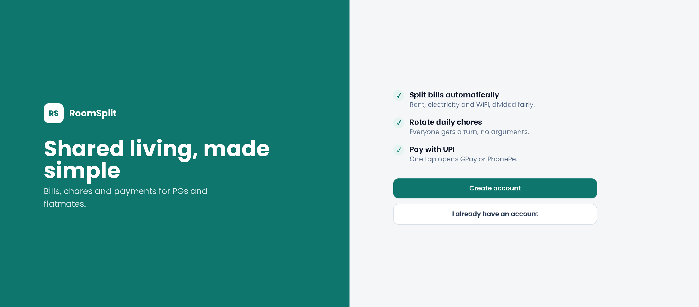
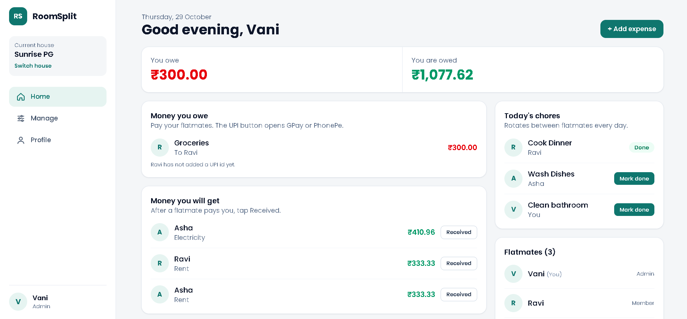
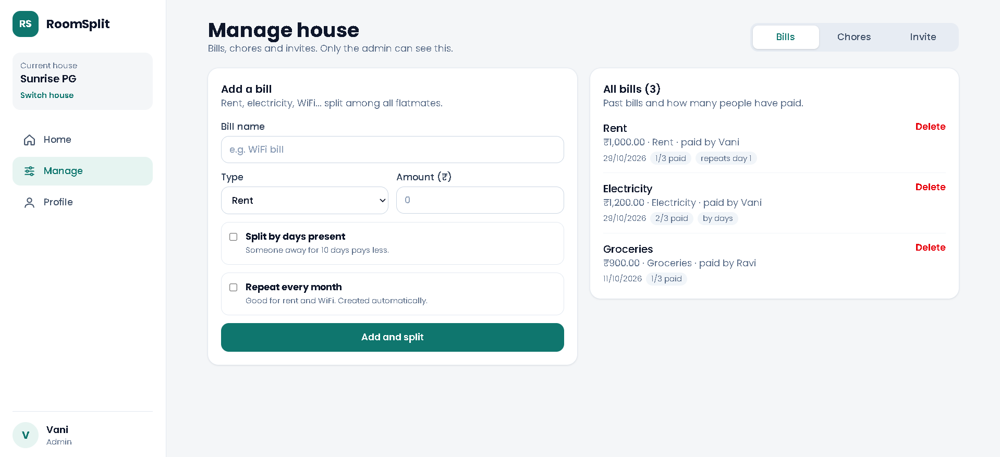
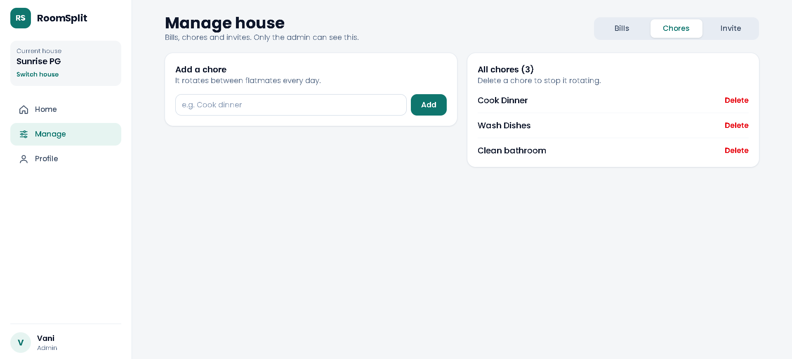
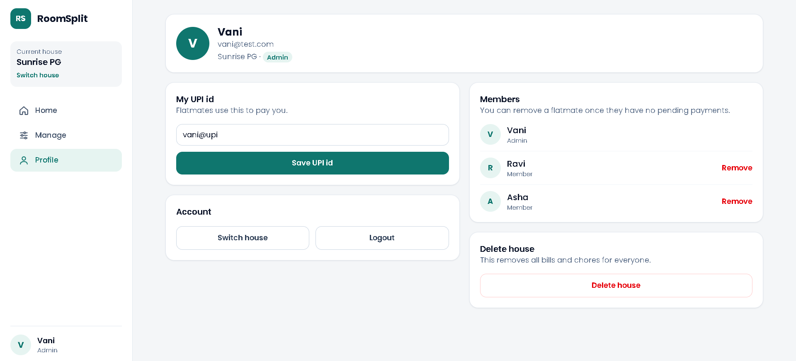
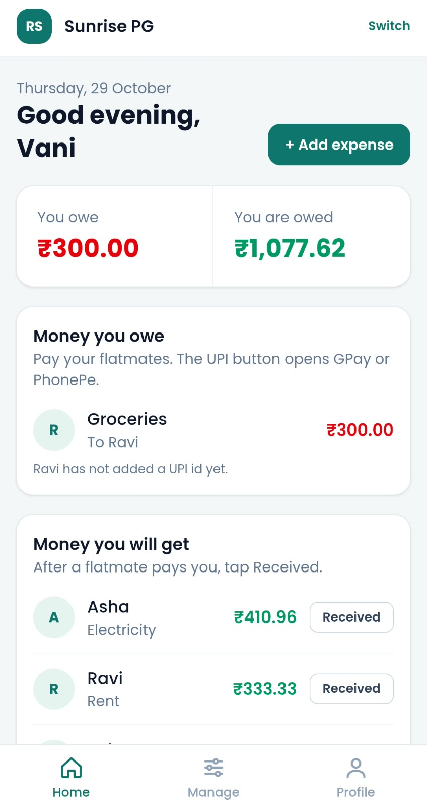
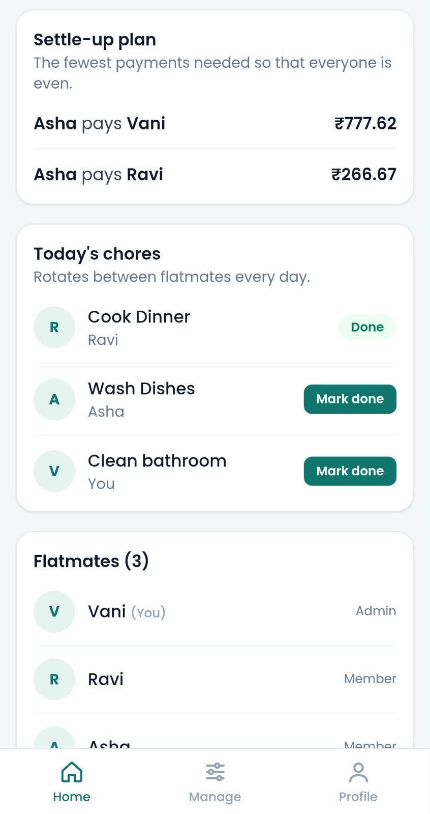
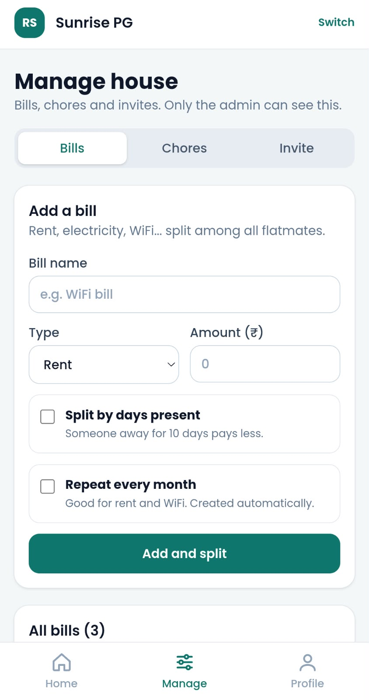

# RoomSplit

Split bills, rotate chores and settle up with UPI. Built for Indian PGs and flatmates.

**Live app:** https://roomsplit-mu-swart.vercel.app/  
**Demo login:** `vani@test.com` / `123456` (admin) or `ravi@test.com` / `123456` (member)

> The backend runs on a free server that sleeps when idle. If the first login is slow, wait about 30 seconds.



## Features

- **Auto bill split:** rent, electricity, WiFi and daily expenses divided among flatmates. Amounts are stored in paise, so shares always add up to the exact total.
- **Split by days present:** someone away for 10 days pays less (largest remainder method).
- **Recurring monthly bills:** rent and WiFi are created automatically by a scheduled job (cron).
- **Debt simplification:** the fewest payments needed to settle everyone.
- **UPI pay link:** one tap opens GPay or PhonePe with the amount filled in.
- **Daily chore rotation:** chores shift between flatmates every day, with no manual work.
- **Roles:** admin and member, with invite codes to join a house, plus leave, remove member and delete house.
- **Responsive and installable:** sidebar on laptop, bottom bar on phone, installable as a PWA.

## Screenshots

| Home | Manage bills |
|---|---|
|  |  |

| Chores | Profile |
|---|---|
|  |  |

### On a phone

<p>
  
  
  
</p>

## Tech stack

| Layer | Tools |
|---|---|
| Frontend | React, TypeScript, Vite, Tailwind CSS, React Router, Axios, PWA |
| Backend | Node.js, Express, TypeScript, Zod, JWT, bcrypt, node-cron |
| Database | PostgreSQL (Neon), Prisma ORM |
| Security | Password hashing, JWT auth, role checks, rate limiting, Helmet, input validation |
| Testing | Vitest (split, debt and rotation logic) |
| Hosting | Vercel (frontend), Render (backend), Neon (database) |

## How it works

```
React app (Vercel)  -->  Express API (Render)  -->  PostgreSQL (Neon)
                              |
                              +-- cron job: monthly bills
```

Some design decisions:

- **Money is an integer in paise**, never a float, to avoid rounding bugs.
- **Chore rotation is calculated from the date**, so no daily job is needed and it never drifts.
- **Members can only leave or be removed when they have no pending payments**, so balances are never lost.

## Run it locally

You need Node.js 20+ and a PostgreSQL database (a free Neon one works).

```bash
git clone https://github.com/Vani-Achar-28/roomsplit.git
cd roomsplit

# Backend
cd server
npm install
```

Create `server/.env`:

```
DATABASE_URL="your-postgres-connection-string"
JWT_SECRET="any-long-random-text"
```

```bash
npx prisma migrate deploy
npm run dev          # http://localhost:4000

# Frontend (new terminal)
cd client
npm install
npm run dev          # http://localhost:5173
```

Run the tests:

```bash
cd server
npm test
```

## Project structure

```
roomsplit/
├── client/   React app (pages, tabs, components)
└── server/
    ├── prisma/       database schema and migrations
    └── src/
        ├── routes/       auth, houses, expenses, chores, payments
        ├── services/     split, debts, rotation (unit tested)
        ├── jobs/         recurring bills
        └── middleware/   auth
```

## Author

Vani Achar - [GitHub](https://github.com/Vani-Achar-28)